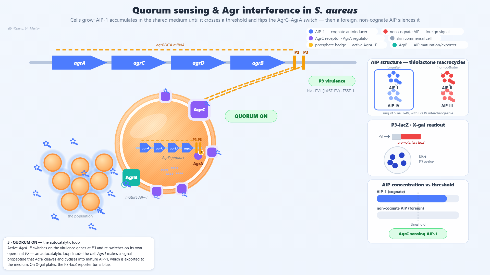
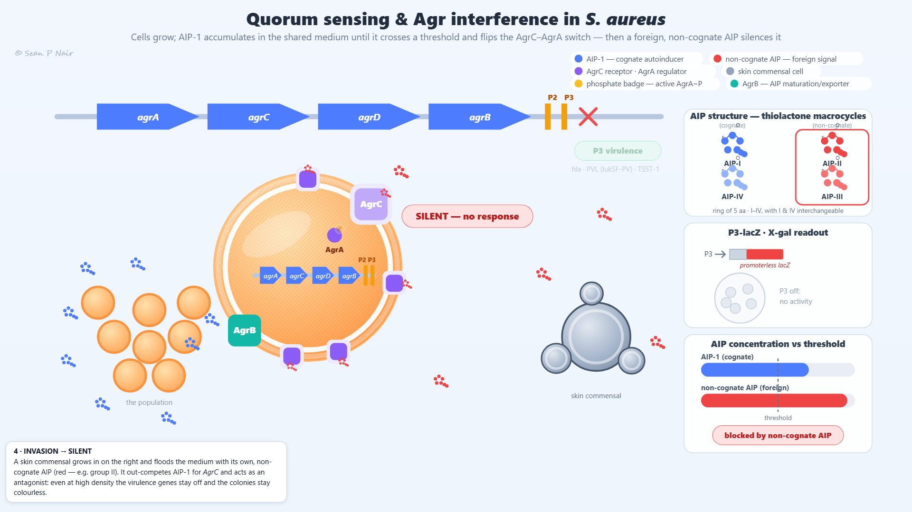

# Quorum sensing & Agr interference in *S. aureus*

A single-file, responsive HTML/SVG animation of **quorum sensing** and its **interference** in *Staphylococcus aureus*: cells grow, the cognate autoinducer **AIP-1** accumulates until it crosses a threshold, and the two-component switch **AgrC–AgrA** fires — first an autocatalytic transcriptional loop (*agrBDCA* at P2), then virulence-gene expression (P3, X-gal blue). Then a skin commensal floods the medium with its own non-cognate AIP that occupies *AgrC* without activating it: even at high density, quorum is silenced. Written for teaching.

No dependencies — open `index.html` in any modern browser. Works on desktop and phone (uniform SVG scaling, viewBox 1600×900), including straight from the filesystem (`file://`). One known limitation: the page never scrolls, so everything must live inside one screen. On phones the 16:9 scene scales down to fit — in portrait the chapter caption and controls sit clear on the letterboxed strip outside the frame, but in landscape there is no empty space left, so the fixed-size caption banner can overlap the lower edge of the scene (and small labels are hard to read either way). For full-size labels use a tablet or desktop.

### **[▶ Watch it here](https://seannair.github.io/Quorum-sensing-Agr-interference-in-S.-aureus/)**

| | | |
|---|---|---|
| **[Quorum sensing & Agr interference in *S. aureus*](https://seannair.github.io/Quorum-sensing-Agr-interference-in-S.-aureus/)** | cells count themselves with AIP-1 — and a foreign signal can silence the quorum | 5 chapters · 48 s loop |




## The loop (48 s, five 9.6-s chapters)

The film is one seamless round of quorum sensing and its interference — frame 0 is identical to frame 48.

| # | Chapter | Starts | What happens on screen |
|---|---------|--------|------------------------|
| 01 | SILENCE | 0 s | a sparse culture: each coccus makes its AIP-1, but at low density the peptide is diluted below threshold (dashed line) — *AgrC* stays unphosphorylated, red ✕ on P2/P3, X-gal dish colourless |
| 02 | GROWTH & ACCUMULATION | 9.6 s | cells divide on the left and each daughter adds its own AIP-1 share (blue meter climbs); mid-chapter the threshold crossing flashes orange — *AgrC* hands a phosphate to *AgrA*, which fires P3 |
| 03 | QUORUM ON | 19.2 s | the autocatalytic loop: amber *agrBDCA* mRNA marching along the operon, AgrA~P docked under P2/P3; inside the cell the *AgrD* propeptide is cleaved and cyclised by *AgrB* into mature AIP-1 that streams out into the population; the dish turns blue |
| 04 | INVASION → SILENT | 28.8 s | a skin commensal slides in on the right, multiplies first, then floods the medium with non-cognate red AIP (e.g. group II); it displaces AIP-1 at *AgrC* — P3 stays off despite high density: colourless = interference, not lysis |
| 05 | RECOVERY & RESET | 38.4 s | the foreign signal washes out; cognate AIP-1 re-binds and the loop refires; then dilution (growth into fresh medium) pushes AIP below threshold again — back to silence, exactly where we started |

## Controls

| Input | Action |
|-------|--------|
| Tap/click on the scene, or the ▶/⏸ button | Play / pause |
| Timeline slider | Scrub to **any** point of the 48-s loop, while playing or paused (doubles as a progress bar with a live "t s" readout) |
| Five chapter dots | Jump to SILENCE / GROWTH & ACCUMULATION / QUORUM ON / INVASION → SILENT / RECOVERY & RESET |
| Speed slider | 0.5×–2× |

With `prefers-reduced-motion` it starts paused. This animation has no sound cues — the story is carried entirely by colour and motion.

### URL modes

| URL | Behaviour |
|---|---|
| `index.html?t=17.5` | Seek to that time (seconds) and **freeze** — handy for sharing a single frame |
| `index.html?render=1` | Hide interactive chrome, letterbox 16:9, freeze at boot — capture mode |
| `index.html?test=1` | Run the built-in self-test; badge bottom-right shows `self-test: PASS/FAIL` (also in console) |

## Where the animation is simplified

Most teaching animations are simplified somewhere. These are the places this one is, so that the exaggerations are not mistaken for scale:

- The cocci and molecules are drawn huge — a coccus is ~1 µm and an AIP monomer ~1 kDa; at true scale neither would be visible in the scene.
- The ten blue / up-to-five red glyph molecules stand for **concentration**, not molecule counts or cell numbers; the threshold meter is a teaching device, not an assay readout.
- One cell's fate carries the whole population story. Real quorum sensing is population-level: the "marching mRNA" and export ring in chapter 3 stand in for what every cell above threshold does at once.
- The skin commensal is a generic coagulase-negative staphylococcus making non-cognate (e.g. group II) AIP; the red signal shows competitive antagonism, not killing — the *S. aureus* population survives and refires when the foreign signal clears.
- The AIP structure inset uses beaded ring glyphs without residue letters, and its "I & IV interchangeable" note is slide-level shorthand (groups I and IV share the closest sequences but are not functionally identical in every assay).
- Time is compressed evenly by design: each chapter gets 9.6 s regardless of how long that state lasts in reality — a real culture can hold quorum for hours, or never reach it.

## Technical notes

Rendering is a pure function of elapsed time — every visual property derives from `render(t)`, so scrubbing, seeking and speed changes are exact, all motion is loop-periodic (frame 0 ≡ frame 48), and captures can be seamless loops. The page exposes a deterministic render hook for screen-capture tooling:

```js
window.__AGRQS = {
  render(t),   // pure function of t — set any frame, no reload needed
  D,           // loop duration (48 s)
  state()      // current simulation state (chapter index, AIP-1/red levels, P3 switch, AgrA stage/phosphorylation…)
}
```

The self-test (`?test=1`) asserts named checkpoints on `state()` fields — `t`, `chapter`, `blue`/`red` (cognate/non-cognate AIP level), `on` (P3 switch 0–1), `density`, `bound` (*AgrC* occupancy), `comm` (commensal cluster growth), `pro` (in-cell production stage), `bind`, `aStage`/`phos` (AgrA travel and phosphorylation), `aip` (mature AIP-1 molecules in the medium) and `xgal` — plus a seam snap proving frame(0) ≡ frame(D).

QA'd with headless Chromium (Playwright) at desktop, phone-portrait and phone-landscape viewports.

## Rendering the MP4

Deterministic frame capture (`_capture.mjs`) + ffmpeg. No MP4 is in this repository yet — render it on request:

```bat
node _capture.mjs
:: → _frames/frame_0000.png … frame_1439.png (Playwright drives window.__AGRQS.render(i/30) at 1920×1080; 1440 frames @ 30 fps = exactly 48 s)
ffmpeg -framerate 30 -start_number 0 -i _frames\frame_%04d.png -c:v libx264 -pix_fmt yuv420p agr_quorum_loop.mp4
```

`node _capture.mjs [start] [endExclusive]` makes the run resumable (e.g. `node _capture.mjs 720 1440`). It reuses the Playwright/Chromium install from `C:\Users\sfaas\html-video\node_modules`. Any ffmpeg with libx264 works — note the one at `D:\RVC1006Nvidia\RVC1006Nvidia\ffmpeg.exe` is built **without** libx264, so use a full build such as the WinGet Gyan.FFmpeg package.

Verify with `ffprobe` (expect 48 s, 1920×1080, 30 fps, 1440 frames) + a full decode pass:
`ffmpeg -v error -i agr_quorum_loop.mp4 -an -f null -`.

## Files

| File | Purpose |
|---|---|
| `index.html` | The animation (self-contained: markup + styles + timeline engine) |
| `LICENSE`, `LICENSE-MIT`, `LICENSE-CC-BY-4.0` | Dual licence — MIT for the software, CC BY 4.0 for the content (captions, visual design, captures); see `LICENSE` for the split and suggested attribution |
| `docs/quorum-on.png`, `docs/invasion-silent.png` | Chapter figures shown above in this README (captured from `?t=24&render=1` and `?t=36.8&render=1`) |
| `_capture.mjs` | MP4 frame-capture harness (Playwright, drives `window.__AGRQS.render`) — see "Rendering the MP4" |
| `_shots.cjs`, `_selftest.cjs` | Playwright QA harnesses (responsive screenshots — extra timestamps as CLI args; self-test run) — not needed to view the animation |
| `_liveshot.cjs` | Live-mode desktop capture helper (`?t=N` with chrome visible) for verifying control-bar/caption fixes that render mode hides |
| `_vision.mjs` | Local QA helper — sends a screenshot to LM Studio and prints a full image description (`node _vision.mjs <png>`) |
| `_syntax.cjs` | Parse-only check of the inline `<script>` (`node _syntax.cjs`) |

## Biology notes & references

Simplified for teaching; species-specific facts verified against primary literature:

- The *agr* locus is ordered **agrbDCA** on screen as *agrA→agrC→agrD→agrB*, with P2 upstream (autocatalytic *agr* transcription) and P3 driving virulence genes including *RNAIII* (Zhang & Ji 2004 — pubmed.ncbi.nlm.nih.gov/15466021; Polaske et al. 2023 — pubmed.ncbi.nlm.nih.gov/38765792).
- AIP-1 is the octapeptide **YSTCDFIM**: a thiolactone ring Cys⁴–Asp⁵–Phe⁶–Ile⁷–Met⁸ with a Tyr-Ser-Thr tail (Hawver et al. 2016 — pubmed.ncbi.nlm.nih.gov/27354348; Lyon et al. 2002 — pubmed.ncbi.nlm.nih.gov/12146974); the ring is essential for activity (Mayville et al. 1999 — pubmed.ncbi.nlm.nih.gov/9990004).
- *AgrB* is a transmembrane cysteine endopeptidase: C-terminal cleavage of the ~45-residue *AgrD* propeptide plus cyclisation to the thiolactone, which also gates export (Zhang & Ji 2004; Polaske et al. 2023).
- The virulence targets named on screen — PVL/lukSF-PV and TSST-1/C3 — are real Agr-dependent *S. aureus* exotoxins (Ramundo et al. 2016 — pubmed.ncbi.nlm.nih.gov/27265234; MDowell et al. 2001 — pubmed.ncbi.nlm.nih.gov/11489134); the P3/RNAIII regulon is reviewed in Williams et al. 2023 — pubmed.ncbi.nlm.nih.gov/37578829.
- AIP groups I–IV (Jarraud et al. 2000 — pubmed.ncbi.nlm.nih.gov/11053400; Stock et al. 2022 — pubmed.ncbi.nlm.nih.gov/36073934), distributed ~60 / 22 / 14 / 2.5 % among clinical isolates (Williams P et al. 2025 — pubmed.ncbi.nlm.nih.gov/40742629). AIP-4 = YSTCYFIM; cross-inhibition EC₅₀s show close relatives still inhibit each other's quorum (Gordon et al. 2013 — pubmed.ncbi.nlm.nih.gov/23294220; Hawver et al. 2016).
- Interference is **antagonism, not an opposite response**: non-cognate AIP occupies *AgrC* without triggering the phosphorylation cascade, so P3 stays off even at high density (Ji et al. 1997 — pubmed.ncbi.nlm.nih.gov/9197262; Jarraud et al. 2000; Lyon et al. 2002).
- The X-gal dish is a **P3→*blaZ*/lacZ** β-galactosidase reporter (blue = P3 active): Geisinger et al. 2008 — pubmed.ncbi.nlm.nih.gov/18222919; the SH101F7 RNAIII::*lacZ* strain is real (Karathanasi et al. 2018 — pmc.ncbi.nlm.nih.gov/articles/PMC5824847); the interference-plate motif follows Canovas et al. 2016, *Front Microbiol*, Fig 1 (pmc.ncbi.nlm.nih.gov/articles/PMC5099252; see also Peng et al. 2019 — pmc.ncbi.nlm.nih.gov/articles/PMC6777374).
- Ecology: coagulase-negative staphylococci block *S. aureus* quorum sensing in vivo, keeping the pathogen's virulence genes off (Paharik et al. 2017 — pubmed.ncbi.nlm.nih.gov/29199097).

## Iteration log

One commit per round; git history allows reverting to any earlier state:

- `5a6c3d3` — baseline: teaching-animation skill templates scaffolded (`__AGRQS` handle)
- `2dbe87e` — full *agr* scene markup + render logic for a 4-chapter loop, captions, legend, self-test
- `237ff89` — rework to the 5-chapter D=48 loop (SILENCE / GROWTH & ACCUMULATION / QUORUM ON / INVASION → SILENT / RECOVERY & RESET): density-driven cocci, threshold-crossing beat, biogenesis micro-scene, thiolactone structure inset, P3-lacZ X-gal dish
- `f2419b7` — marching *agrBDCA* mRNA strand; five staggered-threshold *AgrC* sites with blue/red occupancy across growth and invasion
- `670d964` — numbered chapter captions (1–5); population re-centred left with split-away division motion; commensal divides while producing a drifting red AIP field; *agrD* biology named on the biogenesis scene
- `9e6a8b9` — in-cell *agr* operon copy with P2/P3 and the AgrC→AgrA phosphate hop
- `9ef4c98` — operon corrected to *agrA→agrC→agrD→agrB* with P2/P3 after *agrb*; RNAII dashes march leftward from P2; AgrA binds P2/P3 while quorum is active
- `b9c56f5` — in-cell operon enlarged and shifted left; the skin commensal now multiplies (three daughters) **before** any foreign AIP appears
- `db272b7` — the AgrA phosphorylation journey: travel to *AgrC*, phosphate badge, dock under P2/P3, reversible unbinding when blocked or diluted
- `062a620` — phosphorylation moved inside the cell at the cytoplasmic face of *AgrC*; AIP-1 produced in the multiplying population core; mature-AIP export ring travels fully out through *AgrB*; fixed-width time readout (no control-bar reflow)
- `1ca59bb` — cognate AIP-1 field expanded from 6 to 10 molecules, each secreted by an individual small coccus and diffusing outward; staggered three-ring export stream into the medium
- `2201e90` — caption pill z-index raised 4→7 so the control-bar gradient strip no longer washes over its bottom edge on desktop; `_liveshot.cjs` live-mode capture helper added
